## 航 &nbsp;The Logbook // Prologue

I write my story in pixels — charting the convergence of **physics-informed machine learning**, **autonomous multi-agent coordination**, and **immersive web architectures**.

- ⚛ **Physics-Anchored Learning**: Pure neural nets fail when extrapolating into unfamiliar domains. For **Asian Paints Alchemy 2026**, I engineered [**ANCHOR**](https://github.com/Mxhi-04/Anchor) — anchoring copolymer glass transition ($T_g$) predictions into the 70-year-old Fox equation, letting Gaussian Process residuals learn only what physics misses, and wrapping predictions in honest **90% conformal intervals** that cut laboratory trials by **58%**.
- 🛰️ **Decentralized Multi-Agent Swarms**: When extreme floods knock out communications, central servers go dark. For **Code-E-Manipal 2.0**, I built [**FloodSetu**](https://github.com/Mxhi-04/FloodSetu) — an offline-first rescue dispatch network that runs decentralized **Contract-Net auction negotiations** between rescue drones and boats, paired with an immutable relief ledger.
- 🌊 **Immersive 3D & Creative Playgrounds**: Productivity doesn't have to be sterile. [**Anime Todo**](https://github.com/Mxhi-04/Anime-Todolist) turns deep work into an interactive voyage across 64 curated anime worlds, complete with Three.js ocean stages, an animated Straw Hat companion, dynamic focus timers, and zero-cloud private storage.
- 🛒 **Offline-Resilient Commerce**: With [**VyaparAI**](https://github.com/Mxhi-04/VyaparAI), I engineered a high-speed retail command center for small storefronts: voice-assisted POS, supplier runway forecasting, and a local AI data analyst that runs entirely in the browser.

 

🧭 <b>Log Pose Reading: Coordinates locked… Where are we heading?</b> &nbsp;(click to inspect)

 

> *"Inherited Will, the Swell of the Age, and the Dreams of its People — these are things that will never be extinguished. As long as people seek the answer to freedom, they will continue to explore."*
>
> Across mathematical physics, distributed autonomous swarms, and interactive canvas shaders, every repository is an uncharted island charted and brought to life. **5 flagships** and counting. Keep scrolling to explore the charted sectors. ↓

## 図 &nbsp;Charted Coordinates // Project Domains

Every coordinate charts a distinct engineering domain. Expand a sector to explore the code.

⚛ &nbsp;<b>物 · Physics-Informed ML &amp; Materials Intelligence</b> — mathematical physics meets deep learning

 

| Project | Description | Stack | Status / Links |
|:--|:--|:--|:--|
| [**Anchor**](https://github.com/Mxhi-04/Anchor) | **Physics-anchored, uncertainty-aware copolymer $T_g$ prediction.** Integrates the Fox equation with Gaussian Process residual learning. Delivers 90% conformal prediction intervals and active learning to minimize wet-lab polymer formulation trials. | `Python` `Scikit-Learn` `SciPy` `PINN` | [**Repo**](https://github.com/Mxhi-04/Anchor) · *Asian Paints Alchemy 2026* |

🛰️ &nbsp;<b>網 · Multi-Agent Protocols &amp; Disaster Resilience</b> — decentralized systems when infrastructure fails

 

| Project | Description | Stack | Status / Links |
|:--|:--|:--|:--|
| [**FloodSetu**](https://github.com/Mxhi-04/FloodSetu) | **Decentralized multi-agent flood rescue dispatch engine.** Runs Contract-Net auction protocols between emergency responder agents, offline citizen SOS broadcasts, and a tamper-evident relief ledger with 10/10 safety invariants held across 140 benchmark runs. | `TypeScript` `Multi-Agent` `PNPM` `Vite` | [**Live Demo**](https://floodsetu.vercel.app) · [**Repo**](https://github.com/Mxhi-04/FloodSetu) · *Code-E-Manipal 2.0* |

🌊 &nbsp;<b>境 · 3D Worlds &amp; Immersive Interfaces</b> — web experiences with personality, motion &amp; depth

 

| Project | Description | Stack | Status / Links |
|:--|:--|:--|:--|
| [**Anime-Todolist**](https://github.com/Mxhi-04/Anime-Todolist) | **Grand Line Dashboard &amp; 64-World Productivity Studio.** An anime-inspired personal workspace with ambient live loops, customizable focus timers, dynamic Three.js ocean stage, and private IndexedDB storage. | `JavaScript` `Three.js` `GSAP` `Supabase` `Vite` | [**Live Demo**](https://anime-todolist.vercel.app) · [**Repo**](https://github.com/Mxhi-04/Anime-Todolist) |
| [**Soul-Bites**](https://github.com/Mxhi-04/Soul-Bites) | **Modern Cloud Kitchen food ordering web platform.** High-performance restaurant storefront with reactive menu filtering, cart state management, and streamlined checkout experience. | `React` `TypeScript` `Vite` `Tailwind` | [**Live Demo**](https://soul-bites.vercel.app) · [**Repo**](https://github.com/Mxhi-04/Soul-Bites) |

⚡ &nbsp;<b>商 · Intelligent Systems &amp; Local Commerce</b> — high-impact tooling for small businesses

 

| Project | Description | Stack | Status / Links |
|:--|:--|:--|:--|
| [**VyaparAI**](https://github.com/Mxhi-04/VyaparAI) | **Smart Billing, AI Data Analyst &amp; Inventory Management.** Retail command center designed for neighborhood businesses. Features voice-assisted sales, automated stock runway alerts, cash reconciliation, and conversational business insights. | `JavaScript` `HTML5` `CSS3` `Chart.js` | [**Live Demo**](https://vyaparai-dun.vercel.app) · [**Repo**](https://github.com/Mxhi-04/VyaparAI) |

## 艦 &nbsp;Flagship Artifacts // Visual Showcase

<table>
<tr>
<td align="center" width="50%">

</td>
<td align="center" width="50%">

</td>
</tr>
<tr>
<td align="center" width="50%">

</td>
<td align="center" width="50%">

</td>
</tr>
</table>

✦ Live project metrics — select any artifact to inspect the source ✦  

## 術 &nbsp;The Arsenal // Weapons & Instruments

 

  

<b>⚡ THE AGENTIC &amp; COMPUTATIONAL SYSTEMS I BUILD WITH</b>
  

<table>
<tr>
<td align="center" width="25%">  <b>01 · Antigravity</b> Google — Agentic IDE  </td>
<td align="center" width="25%">  <b>02 · Claude Code</b> Anthropic — Terminal Agent  </td>
<td align="center" width="25%">  <b>03 · Three.js</b> WebGL &amp; 3D Engine  </td>
<td align="center" width="25%">  <b>04 · PyTorch / SciPy</b> Scientific AI &amp; Tensors  </td>
</tr>
</table>

## 記 &nbsp;Voyage Records // Flight Analytics

 

🏆 <b>Achievements unlocked</b>

 

<table border="0">
<tr>
<td align="center" width="16.6%">
  <a href="https://github.com/Mxhi-04?tab=achievements&achievement=galaxy-brain">
     
    <b>Galaxy Brain</b> 
    Community &amp; Answers
  </a>
</td>
<td align="center" width="16.6%">
  <a href="https://github.com/Mxhi-04?tab=achievements&achievement=pull-shark">
     
    <b>Pull Shark</b> 
    Merged PRs
  </a>
</td>
<td align="center" width="16.6%">
  <a href="https://github.com/Mxhi-04?tab=achievements&achievement=pair-extraordinaire">
     
    <b>Pair Extraordinaire</b> 
    Co-authored Merges
  </a>
</td>
<td align="center" width="16.6%">
  <a href="https://github.com/Mxhi-04?tab=achievements&achievement=starstruck">
     
    <b>Starstruck</b> 
    Popular Repository
  </a>
</td>
<td align="center" width="16.6%">
  <a href="https://github.com/Mxhi-04?tab=achievements&achievement=yolo">
     
    <b>YOLO</b> 
    Merged Without Review
  </a>
</td>
<td align="center" width="16.6%">
  <a href="https://github.com/Mxhi-04?tab=achievements&achievement=quickdraw">
     
    <b>Quickdraw</b> 
    Closed Within 5 Min
  </a>
</td>
</tr>
</table>

 

<picture>
  <source media="(prefers-color-scheme: dark)" srcset="https://raw.githubusercontent.com/Mxhi-04/Mxhi-04/output/github-contribution-grid-snake-dark.svg">
  <source media="(prefers-color-scheme: light)" srcset="https://raw.githubusercontent.com/Mxhi-04/Mxhi-04/output/github-contribution-grid-snake.svg">
  
</picture>

🌊 The snake carves an azure wake across a year of commits.

## 連 &nbsp;Transmission // Transmit &amp; Connect

**Have a mission across uncharted waters, an AI problem to anchor in physics, or a world to build in code?**

 

Every commit is a pixel. Every pixel tells a story. &nbsp;·&nbsp; Log Pose Coordinates: 18°N 73°E

