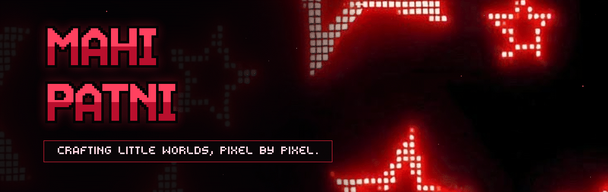
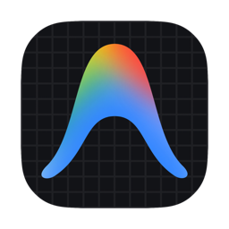
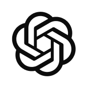

 

## Overview

Crafting little worlds, pixel by pixel — charting the convergence of **physics-informed machine learning**, **autonomous multi-agent coordination**, and **immersive web architectures**.

- **[Anchor](https://github.com/Mxhi-04/Anchor)**: Physics-informed machine learning for materials science (Asian Paints Alchemy 2026), combining the Fox equation with Gaussian Process residual modeling and conformal prediction intervals.
- **[FloodSetu](https://github.com/Mxhi-04/FloodSetu)**: Decentralized multi-agent rescue dispatch engine (Code-E-Manipal 2.0), implementing Contract-Net auction protocols and offline SOS resilience.
- **[Anime Todo](https://github.com/Mxhi-04/Anime-Todolist)**: Immersive 3D interactive productivity environment built with Three.js, GSAP, and private local-first storage.
- **[VyaparAI](https://github.com/Mxhi-04/VyaparAI)**: Intelligent retail billing and inventory management workspace with voice-assisted POS and offline analytics.

 

<b>Philosophy &amp; Direction</b> &nbsp;(click to inspect)

 

> *"Inherited Will, the Swell of the Age, and the Dreams of its People — these are things that will never be extinguished. As long as people seek the answer to freedom, they will continue to explore."*
>
> Across mathematical physics, distributed autonomous swarms, and interactive graphics, every project represents a focused exploration of real-world problems and systems design.

## Engineering Domains

Every coordinate charts a distinct engineering domain. Expand a sector to explore the code.

<b>Physics-Informed Machine Learning &amp; Materials Intelligence</b>

 

| Project | Description | Stack | Status / Links |
|:--|:--|:--|:--|
| [**Anchor**](https://github.com/Mxhi-04/Anchor) | **Physics-anchored, uncertainty-aware copolymer $T_g$ prediction.** Integrates the Fox equation with Gaussian Process residual learning. Delivers 90% conformal prediction intervals and active learning to minimize wet-lab polymer formulation trials. | `Python` `Scikit-Learn` `SciPy` `PINN` | [**Repo**](https://github.com/Mxhi-04/Anchor) · *Asian Paints Alchemy 2026* |

<b>Autonomous Swarms &amp; Multi-Agent Protocols</b>

 

| Project | Description | Stack | Status / Links |
|:--|:--|:--|:--|
| [**FloodSetu**](https://github.com/Mxhi-04/FloodSetu) | **Decentralized multi-agent flood rescue dispatch engine.** Runs Contract-Net auction protocols between emergency responder agents, offline citizen SOS broadcasts, and a tamper-evident relief ledger with 10/10 safety invariants held across 140 benchmark runs. | `TypeScript` `Multi-Agent` `PNPM` `Vite` | [**Live Demo**](https://floodsetu.vercel.app) · [**Repo**](https://github.com/Mxhi-04/FloodSetu) · *Code-E-Manipal 2.0* |

<b>Interactive 3D Web Engineering &amp; Creative Graphics</b>

 

| Project | Description | Stack | Status / Links |
|:--|:--|:--|:--|
| [**Anime-Todolist**](https://github.com/Mxhi-04/Anime-Todolist) | **Grand Line Dashboard &amp; 64-World Productivity Studio.** An anime-inspired personal workspace with ambient live loops, customizable focus timers, dynamic Three.js ocean stage, and private IndexedDB storage. | `JavaScript` `Three.js` `GSAP` `Supabase` `Vite` | [**Live Demo**](https://anime-todolist.vercel.app) · [**Repo**](https://github.com/Mxhi-04/Anime-Todolist) |
| [**Soul-Bites**](https://github.com/Mxhi-04/Soul-Bites) | **Modern Cloud Kitchen food ordering web platform.** High-performance restaurant storefront with reactive menu filtering, cart state management, and streamlined checkout experience. | `React` `TypeScript` `Vite` `Tailwind` | [**Live Demo**](https://soul-bites.vercel.app) · [**Repo**](https://github.com/Mxhi-04/Soul-Bites) |

<b>Intelligent Systems &amp; Retail Infrastructure</b>

 

| Project | Description | Stack | Status / Links |
|:--|:--|:--|:--|
| [**VyaparAI**](https://github.com/Mxhi-04/VyaparAI) | **Smart Billing, AI Data Analyst &amp; Inventory Management.** Retail command center designed for neighborhood businesses. Features voice-assisted sales, automated stock runway alerts, cash reconciliation, and conversational business insights. | `JavaScript` `HTML5` `CSS3` `Chart.js` | [**Live Demo**](https://vyaparai-dun.vercel.app) · [**Repo**](https://github.com/Mxhi-04/VyaparAI) |

## Technical Arsenal

 

  

<b>AGENTIC &amp; COMPUTATIONAL SYSTEMS</b>
  

<table>
<tr>
<td align="center" width="25%">  <b>01 · Antigravity</b> Google — Agentic IDE  </td>
<td align="center" width="25%">  <b>02 · Claude Code</b> Anthropic — Terminal Agent  </td>
<td align="center" width="25%">  <b>03 · ChatGPT Codex</b> OpenAI — Cloud AI Agent  </td>
<td align="center" width="25%">  <b>04 · OpenCode</b> Open Source — Autonomous Agent  </td>
</tr>
</table>

## Analytics & Milestones

 

<b>Achievements Unlocked</b> &nbsp;(<a href="https://github.com/Mxhi-04?tab=achievements">view live profile</a>)

 

<table border="0">
<tr>
<td align="center" width="50%">
  <a href="https://github.com/Mxhi-04?tab=achievements&achievement=yolo">
     
    <b>YOLO</b> 
    Merged Without Review
  </a>
</td>
<td align="center" width="50%">
  <a href="https://github.com/Mxhi-04?tab=achievements&achievement=quickdraw">
     
    <b>Quickdraw</b> 
    Closed Within 5 Min
  </a>
</td>
</tr>
</table>

  Verify unlocked badges on <a href="https://github.com/Mxhi-04?tab=achievements">GitHub Profile Achievements</a>

 

<picture>
  <source media="(prefers-color-scheme: dark)" srcset="https://raw.githubusercontent.com/Mxhi-04/Mxhi-04/output/github-contribution-grid-snake-dark.svg">
  <source media="(prefers-color-scheme: light)" srcset="https://raw.githubusercontent.com/Mxhi-04/Mxhi-04/output/github-contribution-grid-snake.svg">
  
</picture>

Activity tracking across a year of contributions.

## Connect

**Have a mission across uncharted waters, an AI problem to anchor in physics, or a world to build in code?**

 

Every commit is a pixel. Every pixel tells a story. &nbsp;·&nbsp; Log Pose Coordinates: 18°N 73°E

<!-- pair-extraordinaire: github-actions[bot] -->
